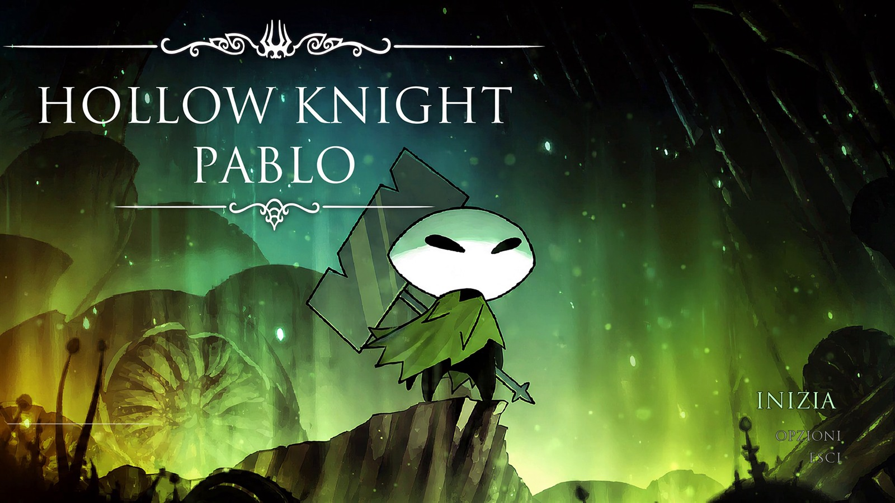
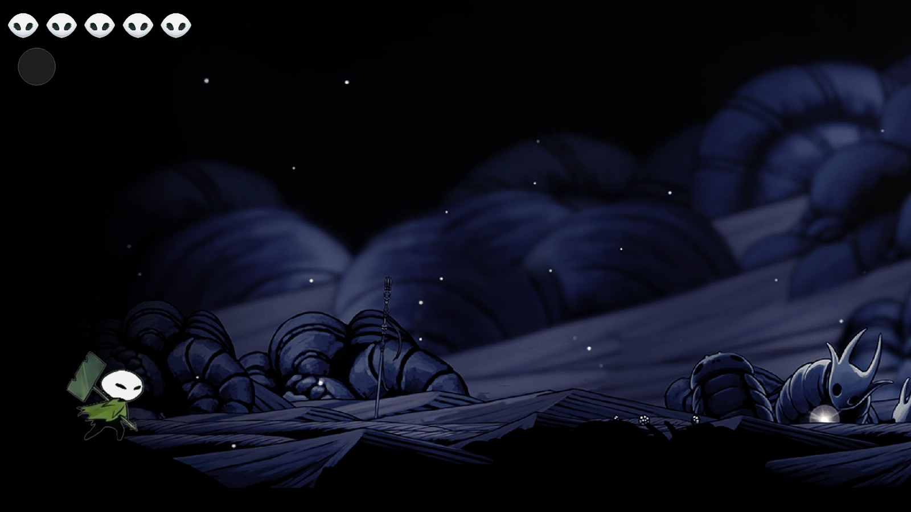

<div align="center">

# HOLLOW KNIGHT · PABLO

### A 2D action-metroidvania built from scratch with Java and libGDX

Five masks, a soul vessel, a dash, a double jump — and a False Knight standing between Pablo
and the end of the kingdom.

[](#tech-stack)
[](#tech-stack)
[](#tech-stack)
[](#world-and-level-design)
[](#tech-stack)

[Overview](#overview) · [Gameplay](#gameplay) · [Controls](#controls) · [Bestiary](#bestiary) · [Under the hood](#under-the-hood) · [Getting started](#getting-started)

<br>



<sub>The animated title screen, built from a 240-frame sequence.</sub>

</div>

---

## Overview

**Hollow Knight: Pablo** is a desktop metroidvania inspired by Team Cherry's *Hollow Knight*. It was
developed as a school project with one rule: build the game loop ourselves, not around an engine.
Movement, physics, combat, enemy AI, animation, audio and map transitions are all written in Java on
top of **libGDX**.

The result is a short but complete vertical slice of a metroidvania:

- A **424-frame animated intro** with its own soundtrack, skippable at any time.
- An **animated title screen** and a full menu system with options and a pause screen.
- **Four connected maps** built in Tiled, traversed through automatic side transitions.
- **Platforming** with responsive jumping, a double jump and an invulnerable dash.
- **Combat** with a nail hitbox, hitstop, screen shake, soul gain and an animated heal.
- **Six enemy types**, each with its own state machine and attack pattern.
- A **multi-phase False Knight boss** with twelve states, a dialogue trigger and a proper death sequence.

<div align="center">
  
  <br>
  <sub>Pablo in the ruins: five masks on the top left, the soul vessel below, and a Husk Hornhead ahead.</sub>
</div>

---

## Gameplay

The loop is deliberately close to the original: explore, fight, heal, push further.

| System | Implementation |
|---|---|
| **Health** | Five masks. One hit removes one mask; at zero, the run ends. |
| **Soul** | A 99-point vessel. Hitting an enemy grants 33 soul; the vessel animates through nine fill levels. |
| **Healing** | Hold the heal input to play a six-frame animation. Health is restored only on the last frame, and taking damage cancels the heal. |
| **Nail combat** | A directional hitbox in front of Pablo. Holding down while attacking produces a downward slash. |
| **Hitstop** | A short freeze on impact makes every hit feel weighted. |
| **Screen shake** | Triggered by heavy attacks and boss landings. |
| **Dash** | 0.18 s of horizontal movement with invulnerability and a 0.6 s cooldown. Direction is locked once started. |
| **Double jump** | One extra jump in the air, restored on landing. |
| **Damage invulnerability** | 1.5 s of blinking immunity after a hit, so contact damage cannot stack. |
| **Map continuity** | Health and soul are saved before a transition and restored on the other side, so the run continues seamlessly. |

### World and level design

The kingdom is split into four Tiled maps connected left-to-right:

```
Mappa1  ⇄  Mappa2  ⇄  Mappa3  ⇄  Mappa4
```

`MapGraph` stores the connections as a static graph. When Pablo reaches a map edge, `LevelScreen`
saves his health and soul, loads the neighbouring `.tmx` and respawns him on the opposite side.
Collision boxes, spawn points and the boss trigger are all authored as object layers in Tiled — the
Java code only reads names such as `start`, `solido`, `spawntp` and `FalseKnight`.

---

## Controls

| Action | Keys |
|---|---|
| Move | `A` / `D` or `←` / `→` |
| Jump | `Space` / `W` |
| Double jump | `Space` / `W` while airborne |
| Dash | `Left Shift` |
| Attack | `J` or **left mouse button** |
| Downward slash | `S` + attack |
| Heal | `F` |
| Interact / boss dialogue | `E` |
| Pause | `Esc` / `P` |
| Skip intro | Any key or click |

The same list is available in-game from **OPZIONI → COMANDI**, next to the SFX and music volume
sliders.

---

## Bestiary

| Enemy | Behaviour |
|---|---|
| **Crawlid** | Slow ground patrol; turns at ledges and deals contact damage. |
| **Tiktik** | Fast, low-profile patroller that turns at walls and can be stunned. |
| **Vengefly** | Hovers in place, startles when Pablo gets close, then chases through the air. |
| **Husk Bully** | Winds up, leaps at the player and is vulnerable during its landing recovery. |
| **Husk Hornhead** | Patrols, anticipates, then charges in a straight line. |
| **Husk Warrior** | Raises a shield against frontal attacks, punishes reckless hits and retaliates with a three-strike combo. |

Every enemy is driven by an enum-based state machine (`PATROL`, `TURNING`, `ATTACK`, `HIT_STOP`,
`DEAD_AIR`, `DEAD_LAND`, …), with dedicated `tick` methods per state and frame-by-frame animations.

### The False Knight

The boss is the technical centrepiece of the project. It has **12 states** and **13 animations**:

```
IDLE → PATROL → TURN
                 ├── ANTICIPATE_ATTACK → ATTACK → RECOVER_ATTACK
                 └── JUMP_ANTICIPATE → JUMP_UP → JUMP_ATTACK_FALL → JUMP_LAND
STAGGER
DEAD
```

- **Close range:** a wind-up, a mace swing and a punishable recovery.
- **Long range:** a jump anticipation, an airborne fall and a landing shockwave with screen shake.
- **Aggro logic:** the boss faces Pablo, respects map edges and picks an attack based on distance.
- **Dialogue:** walking up to the arena and pressing `E` opens the encounter prompt.
- **Death:** a stagger state, a hitstop and a fade-out instead of an instant disappearance.

---

## Under the hood

### Tech stack

| Layer | Technology |
|---|---|
| Language | Java 8 |
| Framework | libGDX 1.9.7 |
| Backend | LWJGL 2 (OpenGL desktop) |
| Maps | Tiled — `.tmx` + object layers |
| Audio | libGDX `Music` and `Sound`, with per-effect cooldowns |
| UI | Scene2D (`Stage`, `Table`, `TextButton`, `Slider`) |
| Persistence | libGDX `Preferences` for audio settings |
| Build | IntelliJ IDEA module with local JARs (no Gradle/Maven) |

### Architecture

```
src/pablo/
├── Launcher.java              # Reads the monitor resolution, opens fullscreen
├── PabloGame.java             # Game entry point, owns the active screen
├── IntroScreen.java           # 424-frame intro + soundtrack, skippable
├── TitleScreen.java           # 240-frame animated title
├── MenuScreen.java            # INIZIA / OPZIONI / ESCI
├── OptionsScreen.java         # Volume sliders + control reference
├── LevelScreen.java           # Gameplay: maps, entities, HUD, transitions
├── PauseScreen.java           # RIPRENDI / OPZIONI / ESCI
├── MapGraph.java              # Static graph of the four maps
├── PlayerState.java           # Health and soul carried between maps
├── GameSettings.java          # Singleton: audio + display preferences
├── SoundManager.java          # Singleton: music, SFX and cooldowns
├── framework/                 # BaseActor, BaseGame, BaseScreen, TilemapActor
└── entities/
    ├── player/                # Pablo + Playerstate FSM
    ├── combat/                # Hitbox
    └── enemies/               # crawlid, tiktik, vengefly, huskBully,
                               # huskHornhead, huskWarrior, falseKnight
```

Three design choices are worth calling out:

**1. Screens as a stack of states.** `BaseGame` swaps the active `Screen`, so the intro, menu,
gameplay, pause and options screens never share lifecycle code. Each screen owns its own Stage,
viewport and input processor.

**2. Singleton services for global state.** `GameSettings`, `SoundManager` and `PlayerState` are
process-wide. That keeps audio settings consistent across screens and lets health and soul survive a
map transition without threading a context object through every constructor.

**3. Streaming frame sequences.** The title and intro are hundreds of full-HD PNGs. Loading them all
would exhaust VRAM, so only the current frame is kept as a `Texture`; the previous one is disposed
before the next is uploaded. The intro advances on accumulated delta time, not on audio position, so
it stays in sync even if the track buffers.

### Assets

- **Sprites and animations** — Pablo, six enemies and the boss, all frame-by-frame.
- **Maps** — four `.tmx` files plus their tilesets.
- **Audio** — two music tracks (`menu.ogg`, `level.ogg`) and separate SFX sets for the player and UI.
- **Fonts** — Trajan Pro for the menus, plus a bitmap font for in-game text.
- **Intro** — a 424-frame sequence with its own MP3.

---

## Getting started

### Requirements

- **JDK 8** (the project targets Java 8 and libGDX 1.9.7)
- A display that supports 1920×1080 — the launcher starts in fullscreen at the monitor's native
  resolution
- IntelliJ IDEA (recommended)

### Run it

1. Clone the repository:
   ```bash
   git clone https://github.com/LucaBert00/HollowKnight-Pablo.git
   cd HollowKnight-Pablo
   ```
2. Open the project in IntelliJ IDEA. The module already marks `src` as a source root.
3. Add every JAR in `lib/` to the module dependencies:
   `File → Project Structure → Modules → Dependencies → + → JARs or directories`.
4. Set the working directory of the run configuration to the **repository root**. All asset paths
   are relative (`assets/...`), so running from anywhere else produces missing-texture fallbacks.
5. Run `pablo.Launcher`.

From a terminal, with the project compiled to `out/production/HollowKnight-Pablo`:

```bash
java -cp "lib/*;out/production/HollowKnight-Pablo" pablo.Launcher
```

> On macOS/Linux replace the `;` with `:`. The game uses the native LWJGL backend, so the JARs with
> `-natives` in their name must stay on the classpath.

### Troubleshooting

| Symptom | Cause / fix |
|---|---|
| Black screen or immediate close | Working directory is not the repository root. |
| `NoClassDefFoundError` on a libGDX class | One or more JARs from `lib/` are missing from the module dependencies. |
| Sprites stretched horizontally | An old `StretchViewport` build; the current code uses `ExtendViewport`. |
| Missing textures | Asset path typo — the game falls back to a 1×1 coloured texture instead of crashing. |
| Fullscreen minimises on focus loss | Expected LWJGL behaviour on Windows; click the window to restore it. |

---

## Documentation

Both documents are in Italian and ship with the repository:

| Document | Contents |
|---|---|
| 📄 **[Relazione Tecnica (PDF)](docs/HollowKnight-Pablo-Relazione-Tecnica.pdf)** | Architecture, map graph, boss state machine, animation systems and debugging log |
| 📊 **[Presentazione (PDF)](docs/HollowKnight-Pablo-Presentazione.pdf)** | Project overview, gameplay and technical highlights |

---

## Roadmap

- [ ] Real save system with checkpoints and multiple slots
- [ ] More areas, abilities and bosses
- [ ] Particle effects for healing, damage and landing dust
- [ ] Controller support
- [ ] Localisation (Italian / English)
- [ ] Packaged executable with bundled JRE

---

## Team

Built for the **Java / libGDX module** of the 4th-year computer science course, class **4ªAI**.

| Name |
|---|
| Luca Bertoldini |
| Andrea Frigerio |
| Lorenzo Giannattasio |
| Chiara Gianola |

Project date **13/05/2026**.

---

<div align="center">
  <sub>
    Fan project made for educational purposes. <i>Hollow Knight</i> and its characters belong to
    Team Cherry. All original code, maps and assets in this repository were created by the team.
  </sub>
</div>
